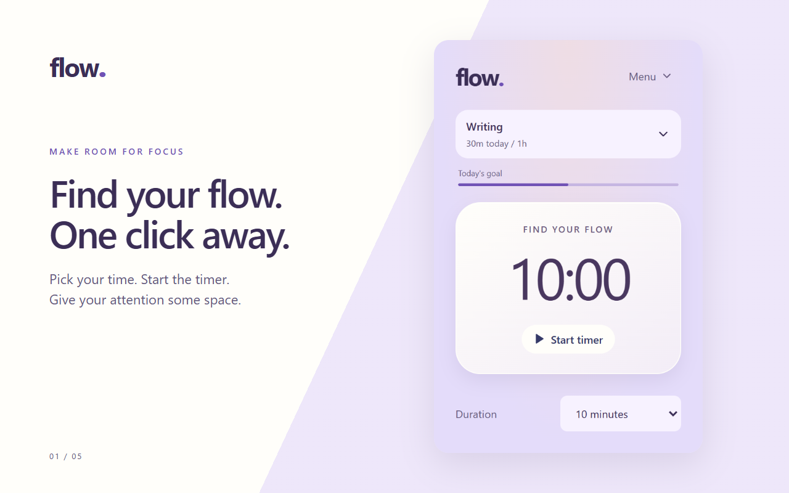
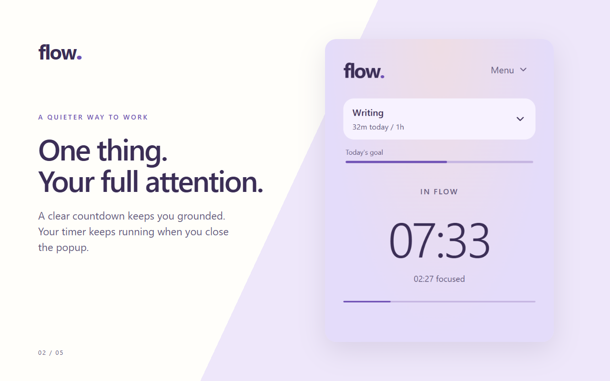
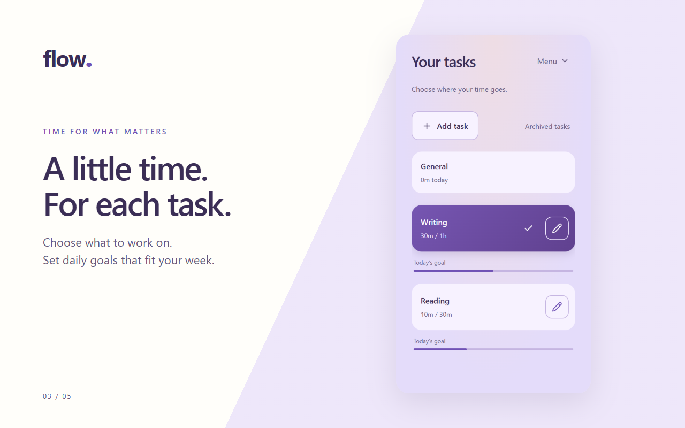
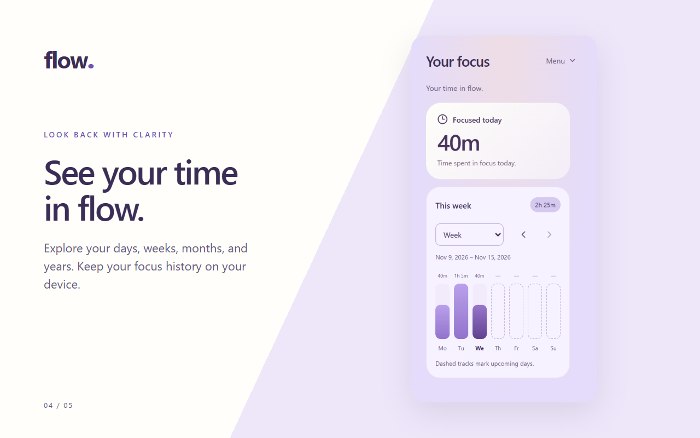
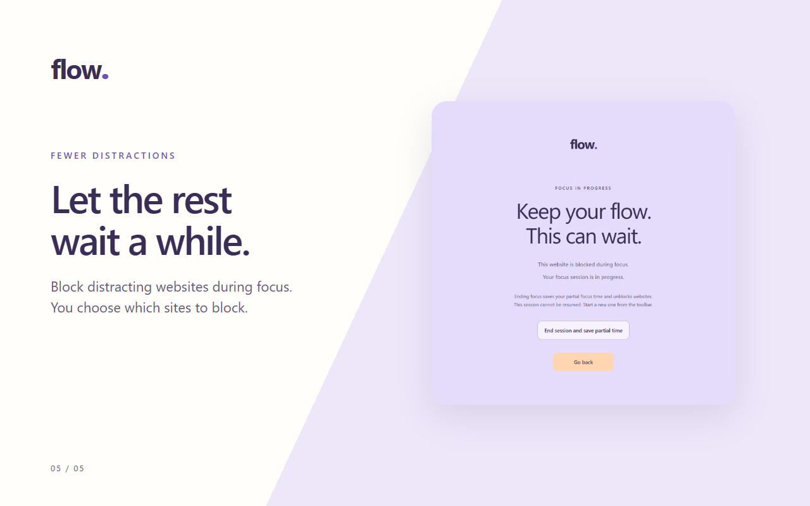

# Flow

A compact Chrome extension for focused work, optional website blocking, and private
focus statistics.

## A look inside Flow

[Watch the narrated promo](assets/video/flow-promo-narrated-1920x1080.mp4)
or the [silent version](assets/video/flow-promo-1280x720.mp4).

The current interface, captured from the extension with illustrative task and
history data. Click an image to view it at full resolution.



| Focus countdown                                                                        | Tasks and daily goals                                                                          |
| -------------------------------------------------------------------------------------- | ---------------------------------------------------------------------------------------------- |
|  |  |

| Focus statistics                                                                   | Website blocking                                                                                       |
| ---------------------------------------------------------------------------------- | ------------------------------------------------------------------------------------------------------ |
|  |  |

## Features

- Start a focus session by clicking the timer. The default is 10 minutes, with
  presets of 10, 20, 30, 60, 90, and 180 minutes, plus custom durations.
- Choose a task or use General. Set recurring daily goals and track time by task.
- Block distracting domains, including already-open websites, after granting
  optional website access.
- Browse calendar week, month, and year graphs with matching task totals and saved
  session history. Day graphs show hours in local time. Weeks start on Monday; yearly bars represent months.
- Expand **All sessions** in Stats to browse saved records, five per page. Collapse
  it again to keep the overview compact.
- Choose light, dark, or system appearance. Hide the home duration selector for a
  simpler, single-button start screen.
- Export and import local backups.

In Settings, turn off **Show task on home** to hide the task selector and goal
progress. Your selected task continues tracking time; tasks remain accessible
through **Menu > Tasks**. Settings and Statistics are in the same menu.

## How sessions work

The timer persists when you close the popup. At the focus target, time stops
counting and website blocking ends. You have 30 seconds to choose **Repeat session**
or **Take a break** from the popup or notification. Otherwise, Flow saves the session
and returns home. Breaks start only when requested; ending a break returns home too.

During a focus countdown, there are no pause or finish controls in the popup. To
interrupt a session, use **End session and save partial time** on Flow's blocked-site
screen or overlay. Partial focus time is saved, and the session cannot be resumed.

Changing tasks during a session requires confirmation. Previously recorded time
stays with its original task, while future focus time goes to the new selection.

Use the **pencil icon** beside a custom task (hover for **Edit task**) to change its name or goal, archive it, or
delete it. Use **Archived tasks** above the list to find tasks you can restore.
Renaming preserves recorded time. Deletion requires
confirmation and removes its goal; past focus remains in statistics as **Deleted
task**. If it is the running task, the timer continues as **General**. General
is the permanent default and cannot be deleted.

Notifications and their action buttons depend on Chrome and operating-system
settings. Deadline recovery runs when Chrome resumes after being closed or asleep.

## Privacy

Tasks, goals, settings, and session history stay in your browser's local extension
storage. Flow does not use accounts, analytics, advertising, or cloud sync.

Website blocking processes tab URLs locally to match your blocklist. It does not
save browsing history or scrape website content. Website access is optional and
can be revoked in Chrome's extension settings.

Saved history has no age-based cutoff, but browser storage limits apply. Export
backups before clearing extension data or uninstalling Flow.

Read the [privacy policy](PRIVACY_POLICY.md) for details about permissions, local
processing, retention, and deletion.

## Build and install locally

Use Node.js 24 and npm.

```sh
npm ci
npm run build
```

Open `chrome://extensions`, enable **Developer mode**, choose **Load unpacked**, and
select the generated `dist/` folder. Pin Flow to the toolbar to open its popup.

For development, `npm run dev` rebuilds on changes. Reload the extension after a
rebuild to pick up updated background code or permissions.

- [Testing and release checklist](docs/TESTING.md)
- [GitHub Actions and publishing setup](.github/RELEASING.md)
- [Versioning and release guide](docs/RELEASES.md)
- [Changelog](CHANGELOG.md)
- [Visual design guide](docs/DESIGN.md)

## Support

Report bugs or suggest improvements through [GitHub issues](https://github.com/ramarahul/Flow/issues).
Include your Chrome version and steps to reproduce. Avoid posting private task
names, browsing details, or exported backups in public issues.

For vulnerabilities, follow the [security reporting policy](SECURITY.md) instead
of opening a public bug report.
